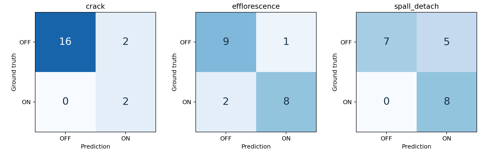
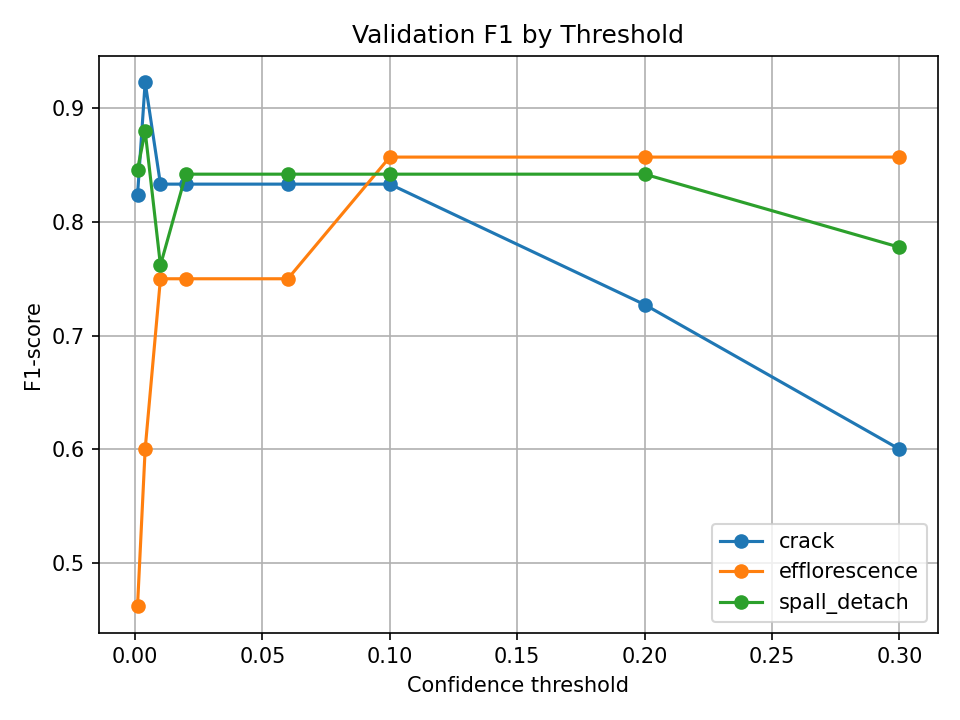

# 지하구조물 표면 결함 탐지 AI 모델 재현 및 성능 평가

딥러닝 최종과제 · Step 3  
사이버보안전공 · 21113718 · 이동현

지하 콘크리트 구조물의 균열, 백태, 박리·박락을 YOLOv8s-Seg로 탐지·분할하였다. 검증셋에서 클래스별 임계값을 정하고 테스트셋에 고정 적용하여 영상 단위 ON/OFF 성능도 확인하였다.

[최종 보고서 PDF](docs/final_report.pdf) · [주석 기준서 수정본](docs/annotation_guideline.md) · [오류 사례 분석](docs/error_analysis.md) · [실행 결과가 포함된 Colab 노트북](notebooks/03_evaluation_executed.ipynb)

현재 결과는 YOLOv8s-Seg 한 모델의 실험이다. 파일명을 추가 점검한 결과, **학습·테스트 사이에 같은 원본 계열이 걸친 사례 3건**을 확인하였다. 아래 수치는 제출된 분할에서 얻은 실습 측정치이며 테스트 독립성에 한계가 있다. 상세 파일명은 [분할 점검 결과](results/source_family_overlap.csv)에 기록하였다.

GitHub Repository · https://github.com/ldhyun5139/concrete-defect-segmentation

## 1. 코드 설명

### 1.1. 사용 데이터 및 전처리

- 실습에 제공된 `사용한 데이터.zip`을 사용하였다. 외부 공개 출처와 라이선스는 제공 파일에서 확인하지 못하였다.
- ZIP에는 JPG 4,116개와 TXT 4,116개가 있다.
- 저장된 분할은 train 3,377장 / val 21장 / test 21장이다. 검증·테스트 그룹에서 증강 표시 영상을 제외한 뒤의 수이다.
- 테스트의 `URT020_2021_04_03_001_2914.jpg`는 0바이트여서 읽지 못하였다. 모델 평가 전에 제외하여 **검증 21장 / 테스트 20장**을 사용하였다. [제외 기록](results/image_read_issues.csv)
- 클래스는 `0=crack`, `1=efflorescence`, `2=spall_detach`이다. 라벨은 YOLO Segmentation 형식이다.
- CVAT에서 직접 주석한 사진은 10장, 인스턴스는 crack 26개 / efflorescence 6개 / spall_detach 9개이다. 이 41개는 주석 실습 결과로 별도 보관하였고, 이번 모델의 학습·평가는 제공 라벨로 수행하였다.
- 모델 입력 크기는 960이다. Mosaic과 MixUp은 각각 0.0으로 두었다. 가는 균열의 세부 정보와 콘크리트 표면의 공간적 맥락, 결함 경계를 보존하려는 설정이다.

기존 `origin_id` 열을 비교하면 split 간 중복은 0건이었다. 추가 점검에서는 `_efflo_bright` 등의 접미사가 원본 ID에 남아 같은 원본 계열이 별도 그룹으로 배정된 것을 확인하였다. 원본 그룹 규칙을 보완한 뒤 학습·평가를 다시 수행할 필요가 있다.

### 1.2. 사용한 AI 모델

| 항목 | 실제 설정 |
|---|---|
| 모델 | YOLOv8s-Seg |
| 초기 가중치 | `yolov8s-seg.pt` |
| 입력 크기 / Batch | 960 / 4 |
| 최대 Epochs / 기록된 Epochs | 60 / 59 |
| Optimizer / 초기 학습률 | AdamW / 0.00015 |
| Seed / patience | 42 / 20 |
| Mosaic / MixUp | 0.0 / 0.0 |

설정은 [학습 인자](results/training_args.yaml), 학습 기록은 [training_results.csv](results/training_results.csv)에 보관하였다. 여러 모델을 학습한 비교 실험은 수행하지 않아 이번 결과에는 한 모델을 기록하였다.

### 1.3. 학습 및 테스트 방법

1. 제공 라벨의 이미지 대응, 클래스 ID, 폴리곤 좌표를 점검하였다.
2. 저장된 원본 ID 분할로 학습하고 검증 결과에 따라 저장된 `best.pt`를 사용하였다.
3. 테스트셋에서 mask mAP50 및 mAP50-95를 구하였다.
4. 검증셋에서만 클래스별 confidence threshold를 탐색하였다. 최고 F1이 같으면 낮은 임계값을 선택하였다.
5. 선택한 임계값을 테스트셋에 고정 적용하여 클래스별 TP·FP·FN·TN을 집계하였다.
6. 오류 사진과 제공 라벨을 대조하고 원인을 분석하였다.

### 1.4. 실행 방법

Colab GPU 런타임에서 [3주차 노트북](notebooks/03_evaluation.ipynb)을 열고 0~10번 셀을 순서대로 실행한다. 0번 셀의 원본 ZIP, `best.pt`, `split_manifest.csv` 경로를 본인의 Drive 위치에 맞춘다. 원본 데이터 ZIP은 별도로 준비한다.

가중치는 `weights/best.pt.part01`~`part03` 세 파일로 보관하였다. 저장소를 내려받은 뒤 다음 명령을 실행하면 SHA-256을 검증하여 원래의 `weights/best.pt`를 복원한다. 복원한 파일을 Colab의 준비 셀에서 지정한 Drive 경로에 넣는다.

```bash
python src/restore_weights.py
```

기록된 실행 환경은 Python 3.13.16, PyTorch 2.14.1+cu130, CUDA 13.0, Ultralytics 8.4.216, Tesla T4이다. [환경 기록](results/environment.json)

결과 파일의 집계와 분할 점검은 다음 명령으로 다시 확인할 수 있다.

```bash
pip install -r requirements.txt
python src/audit_results.py --results results
```

학습 코드와 당시 분할 규칙은 [2주차 노트북](notebooks/02_training.ipynb)에 보관하였다. 직접 주석 라벨 대체는 이번 실험에 맞춰 기본값을 False로 두었다. 추가 분할 점검에서 발견한 접미사 처리 문제는 보고서 6절에 기록하였다.

### 1.5. 코드 파일 설명

| 파일 | 내용 |
|---|---|
| `notebooks/02_training.ipynb` | 2주차 데이터 준비·분할·학습 코드 |
| `notebooks/03_evaluation.ipynb` | 3주차 평가와 임계값 탐색 코드 |
| `notebooks/03_evaluation_executed.ipynb` | 실제 평가 출력이 포함된 노트북 |
| `src/audit_results.py` | 검증 임계값·테스트 집계·원본 계열 중복 점검 |
| `weights/best.pt.part01`~`part03` | 원본 가중치를 나눈 파일 |
| `src/restore_weights.py` | 분할 가중치 복원 및 SHA-256 검증 |
| `results/` | 수치, 곡선, 혼동행렬, 오류 사진과 실행 기록 |

## 2. 모델 성능

### 2.1. 테스트셋 성능

Accuracy·Precision·Recall·F1은 클래스별 영상 단위 ON/OFF 지표를 계산한 뒤 세 클래스를 동일한 가중치로 평균하였다. mask mAP는 인스턴스 마스크 평가 결과이다.

| 모델 | Accuracy (macro) | Precision (macro) | Recall (macro) | F1 (macro) | mask mAP50 | mask mAP50-95 |
|---|---:|---:|---:|---:|---:|---:|
| YOLOv8s-Seg | 0.8333 | 0.6681 | 0.9333 | 0.7569 | 0.7462 | 0.3851 |

### 2.2. 클래스별 세그멘테이션 성능

| 클래스 | 정답 ON 영상 | mask AP50 | mask AP50-95 |
|---|---:|---:|---:|
| crack | 2 | 0.8283 | 0.3808 |
| efflorescence | 10 | 0.6828 | 0.4784 |
| spall_detach | 8 | 0.7276 | 0.2961 |

전체 테스트는 20장, 정답 인스턴스는 24개였다. [전체 결과](results/test_segmentation_overall.csv) · [클래스별 결과](results/test_segmentation_by_class.csv)

### 2.3. 클래스별 ON/OFF 결과

| 클래스 | 검증에서 선택한 임계값 | TP | FP | FN | TN | Precision | Recall | F1 |
|---|---:|---:|---:|---:|---:|---:|---:|---:|
| crack | 0.004 | 2 | 2 | 0 | 16 | 0.5000 | 1.0000 | 0.6667 |
| efflorescence | 0.100 | 8 | 1 | 2 | 9 | 0.8889 | 0.8000 | 0.8421 |
| spall_detach | 0.004 | 8 | 5 | 0 | 7 | 0.6154 | 1.0000 | 0.7619 |

macro F1은 0.7569이다. [원본 결과표](results/test_onoff_results.csv)

### 2.4. 결과 해석

백태의 ON/OFF F1이 0.8421로 가장 높았다. 균열은 정답 ON 2장을 모두 찾았지만 오탐도 2장 발생해 Precision이 0.5로 낮아졌다. 박리·박락은 미탐 0장, 오탐 5장이었다. 낮은 임계값에서 표면 질감이나 침착물 주변에도 반응한 사례를 확인하였다.

mask mAP50과 mAP50-95의 차이는 엄격한 IoU 조건에서 영역 일치도가 낮아지는 양상을 보여준다. 균열 AP50은 높았지만 양성 사진이 2장이므로 표본 수를 함께 고려해야 한다.

## 3. Confusion Matrix 분석



각 패널에서 행은 정답, 열은 예측이며 OFF·ON 순서이다. 행렬은 `[[TN, FP], [FN, TP]]`로 구성하였다.

- 균열은 FN 0건, FP 2건이었다. 작은 양성 표본과 라벨 누락 가능성을 함께 검토해야 한다.
- 백태는 FP 1건, FN 2건이었다. 밝기 변화와 경계가 흐린 영역이 대표 오류에 포함되었다.
- 박리·박락은 FP 5건으로 세 클래스 중 가장 많았다. 흰 침착물과 거친 표면의 혼동 사례가 있었다.

Ultralytics가 저장한 인스턴스 단위 혼동행렬도 [segmentation_test](results/segmentation_test)에 보관하였다. 위 그림은 별도로 계산한 영상 단위 ON/OFF 혼동행렬이다.

클래스별 대표 사진과 원인 분석은 [오류 분석 문서](docs/error_analysis.md)에 정리하였다. 균열과 박리·박락의 FN은 0건으로 별도 FN 그림이 없다.

## 4. 최종 결과와 한계

테스트 20장에서 mask mAP50 0.7462, mask mAP50-95 0.3851, ON/OFF macro F1 0.7569를 얻었다. 결함 포함 영상을 찾는 과정에서는 높은 Recall과 함께 오탐이 늘어나는 양상도 확인하였다. 지표와 오류 사진을 함께 보니 낮은 임계값에서의 표면 질감 반응과 제공 라벨의 모호성을 살펴볼 수 있었다.

평가 이후 원본 파일명을 점검하는 과정에서 분할의 한계가 드러났다. 같은 원본 계열인 `URT007_2022_01_13_001_3754`, `URT007_2022_01_13_001_5468`, `URT008_2022_01_07_001_6854`가 train과 test에 걸쳐 있었다. **현재 수치는 이 분할에 대한 실습 결과이며, 독립적인 테스트 성능을 확인하려면 원본 계열을 통합해 재분할한 뒤 학습·평가를 다시 수행해야 한다.**

검증 21장과 테스트 20장으로 표본이 작고, 일부 클래스의 양성 사진도 적다. 제공 라벨의 경계·분류 모호성, 한 모델·한 시드의 실험, 물리 단위의 균열 폭·면적을 구할 수 없다는 점도 한계이다.

## 5. 검증셋 임계값 설계



| 클래스 | 선택 임계값 | 검증 F1 | 선택 근거 |
|---|---:|---:|---|
| crack | 0.004 | 0.9231 | 검증 F1 최고점이며 FP 0건이었다. |
| efflorescence | 0.100 | 0.8571 | 0.1·0.2·0.3의 F1이 같아 낮은 0.1을 골랐다. |
| spall_detach | 0.004 | 0.8800 | 검증 F1 최고점에서 정답 ON 11장을 모두 찾았다. |

코드에서는 `onoff(model, val_imgs, val_gts, t, cid)`로 후보를 비교한 뒤 `best`를 저장하였다. 테스트에는 `onoff(model, test_imgs, test_gts, best[name], cid)`로 적용하였다. 저장된 JSON의 `selected_on`은 `val`이며 JSON과 테스트 결과표의 임계값이 모두 일치한다. [선택 기록](results/selected_thresholds.json) · [후보별 점수](results/val_threshold_scores.csv)

## 6. 재현성 점검 기록

- 검증셋에서 선택한 임계값과 테스트 적용 값의 일치를 대조하였다.
- 테스트 TP·FP·FN·TN을 영상별 점수 CSV에서 다시 집계해 결과표와 일치함을 확인하였다.
- 모델 및 분할 파일의 SHA-256이 임계값 선택 기록과 일치하였다.
- 0바이트 영상 1장은 모델 평가 전에 제외하였고 세그멘테이션과 ON/OFF 평가에 같은 20장을 사용하였다.
- 기록된 원본 ID 중복은 0건이지만 추가 파일명 점검에서는 원본 계열 3건의 train/test 중복이 확인되었다.

[집계·분할 점검 JSON](results/result_audit.json) · [실제 평가 목록](results/evaluation_manifest.csv)

## 참고 강의

Step 3 지하구조물 결함 탐지 강의 및 1~3주차 실습 자료를 참고하였다. 강의 논문의 수치를 이번 실험 결과에 대입하지 않았다.
