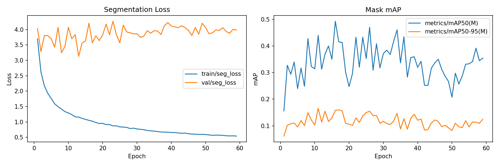

# Concrete Defect Segmentation

콘크리트 표면의 **균열·백태·박리 및 박락**을 찾고, 결함의 위치를 마스크로 표시하는 컴퓨터 비전 프로젝트이다. YOLOv8s-Seg를 학습하고 세그멘테이션 성능과 이미지 단위 결함 유무를 함께 평가하였다.

작성자: 이동현

[프로젝트 보고서](docs/project_report.pdf) · [주석 기준서](docs/annotation_guideline.md) · [오류 분석](docs/error_analysis.md) · [평가 실행 기록](notebooks/evaluation_results.ipynb)

## 1. 프로젝트 목표와 구현 범위

사진에 결함이 있는지 판정하는 것과 결함 경계를 정확하게 찾는 것은 다른 문제이다. 이 프로젝트에서는 두 결과를 따로 측정하였다. 마스크에는 AP를 사용하고, 이미지마다 각 클래스가 있는지 판단하는 ON/OFF 결과에는 Precision·Recall·F1을 사용하였다.

구현한 내용은 다음과 같다.

- 이미지와 YOLO 폴리곤 라벨의 대응, 클래스 ID, 좌표 범위를 점검하였다.
- 파일명에서 원본 ID를 추출해 분할 기록을 저장하고, 평가 시 같은 이미지 구성을 복원하였다.
- YOLOv8s-Seg 사전학습 가중치에서 모델을 학습하였다.
- 검증셋에서 클래스별 confidence 임계값을 선택하고 테스트셋에는 변경 없이 적용하였다.
- FP·FN 이미지를 제공 라벨과 대조하고, 라벨 누락 가능성과 클래스 혼동을 검토하였다.
- 모델·분할 기록의 해시와 영상별 점수를 저장하고 집계를 다시 확인하는 코드를 작성하였다.

## 2. 데이터와 학습 설정

### 2.1. 데이터 구성

입력은 콘크리트 표면 이미지와 YOLO Segmentation 라벨이 담긴 `사용한 데이터.zip`이다. 외부 공개 출처와 라이선스를 확인하지 못하여 데이터 원본은 저장소에 포함하지 않았다.

| 항목 | 구성 |
|---|---|
| 원본 ZIP | JPG 4,116개 / TXT 4,116개 |
| 클래스 | `0=crack`, `1=efflorescence`, `2=spall_detach` |
| 저장된 분할 | train 3,377장 / val 21장 / test 21장 |
| 실제 평가 | 검증 21장 / 테스트 20장 |
| 제외 파일 | 0바이트 테스트 이미지 1장 |
| 직접 주석 | 10장 / 균열 26개·백태 6개·박리 및 박락 9개 |

직접 작성한 폴리곤 41개는 주석 검토 자료로 별도 관리하였다. 기록된 모델의 학습·평가에는 데이터에 포함된 기존 라벨을 사용하였다. [읽기 오류 기록](results/image_read_issues.csv) · [실제 평가 목록](results/evaluation_manifest.csv)

**분할 점검에서 같은 원본 계열 3건이 train과 test에 걸쳐 있음을 확인하였다.** 아래 성능은 이 분할에서 얻은 측정치이며, 독립적인 테스트 성능으로 일반화할 수 없다. 상세 원인과 개선 방향은 6절에 정리하였다.

### 2.2. 모델 설정

| 항목 | 설정 |
|---|---|
| 모델 / 초기 가중치 | YOLOv8s-Seg / `yolov8s-seg.pt` |
| 입력 크기 / batch | 960 / 4 |
| 최대 epoch / 기록된 epoch | 60 / 59 |
| optimizer / 초기 학습률 | AdamW / 0.00015 |
| seed / patience | 42 / 20 |
| Mosaic / MixUp | 0.0 / 0.0 |

입력 크기 960은 가는 균열의 세부 형태를 보존하려는 설정이다. Mosaic은 콘크리트 표면의 공간적 맥락을 바꾸고 MixUp은 결함 경계를 흐릴 수 있어 둘 다 비활성화하였다.



[학습 인자](results/training_args.yaml) · [epoch별 기록](results/training_results.csv)

## 3. 평가 결과

### 3.1. 테스트셋 성능

| 모델 | mask mAP50 | mask mAP50-95 | ON/OFF macro Precision | ON/OFF macro Recall | ON/OFF macro F1 |
|---|---:|---:|---:|---:|---:|
| YOLOv8s-Seg | 0.7462 | 0.3851 | 0.6681 | 0.9333 | 0.7569 |

테스트는 20장, 제공 라벨의 결함 인스턴스는 24개였다. mask mAP와 영상 단위 ON/OFF 지표는 평가 단위가 다르다. 모델 비교 실험과 반복 seed 실험은 수행하지 않았다.

### 3.2. 클래스별 마스크 성능

| 클래스 | 라벨상 ON 이미지 | mask AP50 | mask AP50-95 |
|---|---:|---:|---:|
| crack | 2 | 0.8283 | 0.3808 |
| efflorescence | 10 | 0.6828 | 0.4784 |
| spall_detach | 8 | 0.7276 | 0.2961 |

[전체 마스크 지표](results/test_segmentation_overall.csv) · [클래스별 지표](results/test_segmentation_by_class.csv)

### 3.3. 이미지 단위 ON/OFF

| 클래스 | 선택 임계값 | TP | FP | FN | TN | Precision | Recall | F1 |
|---|---:|---:|---:|---:|---:|---:|---:|---:|
| crack | 0.004 | 2 | 2 | 0 | 16 | 0.5000 | 1.0000 | 0.6667 |
| efflorescence | 0.100 | 8 | 1 | 2 | 9 | 0.8889 | 0.8000 | 0.8421 |
| spall_detach | 0.004 | 8 | 5 | 0 | 7 | 0.6154 | 1.0000 | 0.7619 |

균열은 라벨상 ON 2장을 모두 찾았지만 제공 라벨 기준 FP도 2장이었다. 박리 및 박락은 Recall이 1.0인 대신 FP가 5장이었다. 낮은 임계값에서 약한 반응도 채택하면서 표면 질감이나 침착물 주변까지 검출한 사례가 있었다.


행은 제공 라벨, 열은 예측이며 OFF·ON 순서이다. 각 행렬은 `[[TN, FP], [FN, TP]]`로 구성하였다. Ultralytics의 인스턴스 단위 혼동행렬은 [별도 폴더](results/segmentation_test)에 있다.

[ON/OFF 결과표](results/test_onoff_results.csv) · [영상별 점수](results/image_onoff_scores.csv)

## 4. 검증셋에서 임계값 선택

검증셋의 클래스별 F1이 가장 높은 임계값을 선택하였다. 최고 F1이 같으면 더 낮은 임계값을 택했다. 테스트 결과를 보고 임계값을 바꾸지 않았다.


| 클래스 | 선택 임계값 | 검증 F1 | 선택 근거 |
|---|---:|---:|---|
| crack | 0.004 | 0.9231 | 검증 F1 최고점, FP 0건 |
| efflorescence | 0.100 | 0.8571 | 0.1·0.2·0.3의 F1이 같아 낮은 값 선택 |
| spall_detach | 0.004 | 0.8800 | 검증 F1 최고점에서 라벨상 ON 11장 검출 |

평가 코드는 검증에서 `onoff(model, val_imgs, val_gts, t, cid)`로 후보를 비교하고, 테스트에서는 `onoff(model, test_imgs, test_gts, best[name], cid)`로 저장된 값을 적용한다. 선택 기록의 `selected_on`은 `val`이며 결과표와 임계값이 일치하는지 별도 코드로 점검하였다.

[선택 임계값](results/selected_thresholds.json) · [후보별 검증 점수](results/val_threshold_scores.csv)

## 5. 오류 분석

[오류 분석 문서](docs/error_analysis.md)에 클래스별 대표 이미지와 검토 내용을 정리하였다. 왼쪽은 해당 클래스의 제공 라벨, 오른쪽은 모델 예측이다. 제공 라벨에 결함이 없다고 실제 결함까지 없다고 단정하지 않았다.

육안 검토에서 예측 영역에 해당 결함이 보인 균열 FP 후보 1건과 백태 FP 후보 1건은 대표 오탐 그림에서 제외하였다. 라벨 누락 여부를 검토할 대상으로 기록하고, 성능표는 기존 라벨 기준 평가 결과를 유지하였다. 균열과 박리 및 박락의 FN은 0건으로 별도 FN 그림이 없다.

## 6. 확인한 한계와 개선 방향

- **원본 계열 중복:** `_efflo_bright`, `_efflo_hflip` 같은 접미사가 원본 ID에 남아 동일 원본이 별도 그룹에 배정되었다. `URT007_2022_01_13_001_3754`, `URT007_2022_01_13_001_5468`, `URT008_2022_01_07_001_6854`에서 train/test 중복을 확인하였다. 원본 계열을 통합해 재분할하고 학습·평가를 다시 수행해야 한다.
- **작은 평가 표본:** 검증 21장, 테스트 20장이다. 특히 테스트 균열 양성이 2장이어서 한 이미지의 판정 변화가 지표에 미치는 영향이 크다.
- **라벨의 모호성:** 일부 FP 후보에서 실제 결함이 보였고, 일부 백태 라벨은 경계와 분류가 모호하였다. 모델의 오탐과 라벨 누락을 구분해 검토해야 한다.
- **실험 범위:** 한 모델·한 seed의 실험이며 촬영 거리나 실제 길이 기준이 없어 균열 폭과 결함 면적을 물리 단위로 환산하지 않았다.

[원본 계열 중복 목록](results/source_family_overlap.csv) · [집계 점검 결과](results/result_audit.json)

## 7. 실행 방법

### 7.1. 가중치 복원

저장소를 내려받고 다음 명령을 실행한다. 세 부분으로 나눈 파일을 합친 뒤 SHA-256을 검증하여 `weights/best.pt`를 복원한다.

```bash
python src/restore_weights.py
```

### 7.2. Colab 실행

[학습 노트북](notebooks/train.ipynb)은 데이터 준비·분할·학습을 수행한다. [평가 노트북](notebooks/evaluate.ipynb)은 저장된 모델과 분할을 불러와 마스크 지표, 임계값, ON/OFF 결과와 오류 이미지를 생성한다. 0번 셀의 경로를 준비한 데이터와 모델 위치에 맞춘다.

공유용 기본 Drive 폴더는 `/content/drive/MyDrive/concrete-defect-segmentation`이다. 데이터 ZIP과 `training/split_manifest.csv`, 복원한 `training/runs/baseline_seg/weights/best.pt`를 준비한다. 평가 결과는 `evaluation/results`에 저장한다. 기존 실행 기록의 절대 경로도 같은 폴더명으로 정리하였으며 측정 수치와 샘플 구성은 유지하였다.

기록된 환경은 Python 3.13.16, PyTorch 2.14.1+cu130, CUDA 13.0, Ultralytics 8.4.216, Tesla T4이다. [환경 기록](results/environment.json)

### 7.3. 저장된 결과 점검

```bash
pip install -r requirements.txt
python src/audit_results.py --results results
```

검증 임계값과 테스트 적용 값, 영상별 TP·FP·FN·TN 집계, 모델 및 분할 식별 정보를 대조한다. 학습 노트북에는 기록된 실험의 분할 함수를 보존하였다. 원본 계열 통합 문제는 위 한계와 함께 해석한다.

## 8. 저장소 구성

| 경로 | 내용 |
|---|---|
| `notebooks/train.ipynb` | 데이터 점검·분할·학습 |
| `notebooks/evaluate.ipynb` | 세그멘테이션·ON/OFF 평가와 임계값 탐색 |
| `notebooks/evaluation_results.ipynb` | 평가 출력이 담긴 실행 기록 |
| `src/audit_results.py` | 결과 집계와 원본 계열 중복 점검 |
| `src/restore_weights.py` | 모델 가중치 복원과 SHA-256 검증 |
| `docs/` | 프로젝트 보고서·주석 기준서·오류 분석 |
| `results/` | 지표·곡선·평가 목록·오류 사례 |
| `weights/` | 분할 저장한 학습 가중치 |

구현에는 Ultralytics YOLO를 사용하였다. [Ultralytics](https://github.com/ultralytics/ultralytics) · [평가 지표 문서](https://docs.ultralytics.com/reference/utils/metrics/)
