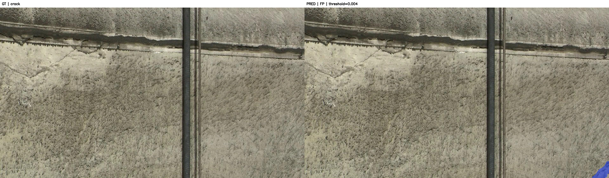
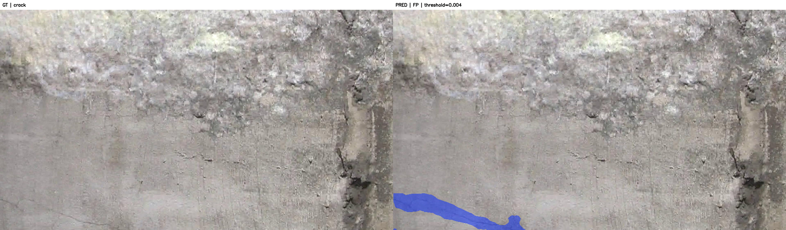
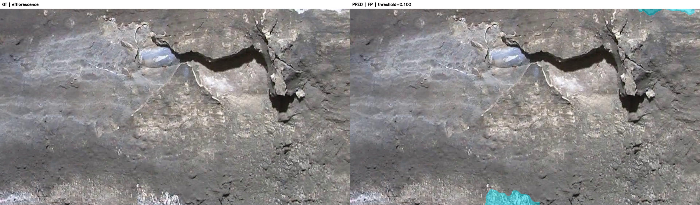
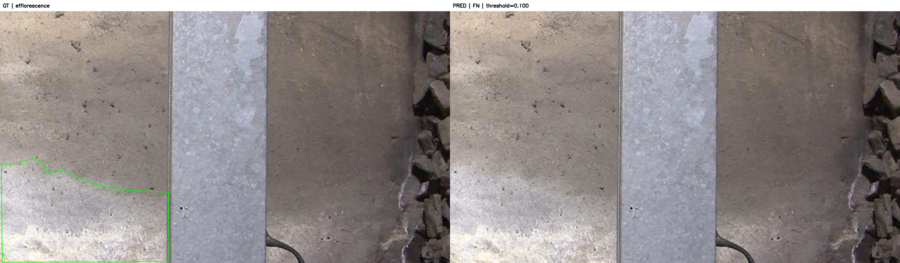
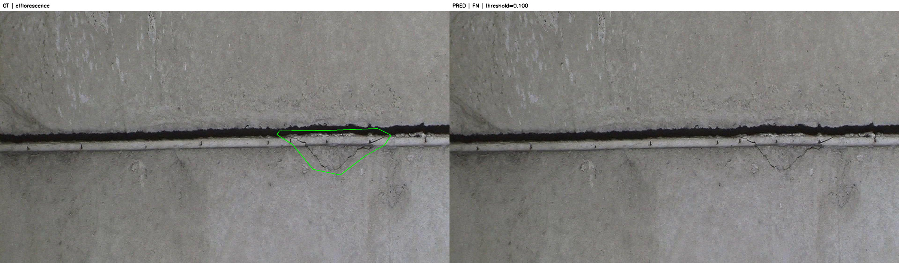
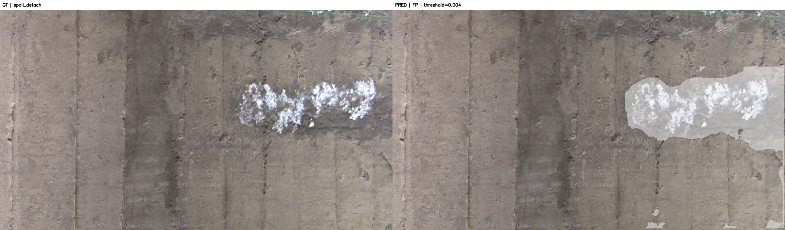
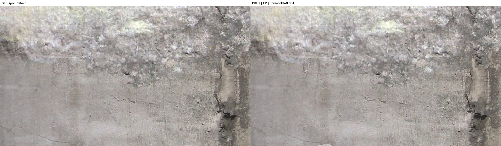
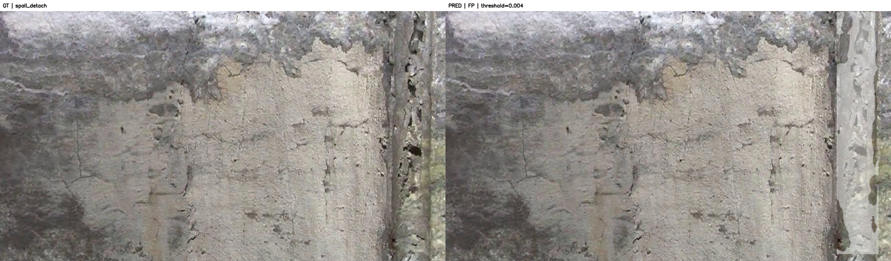

# 오류 사례 분석

왼쪽은 해당 클래스의 제공 정답, 오른쪽은 검증에서 선택한 임계값을 적용한 예측이다. 원인은 저장된 그림에서 확인한 내용과 추정으로 구분하였다. 제공 라벨에 클래스가 없는 사진은 영상 단위 평가에서 FP로 집계된다.

## 1. 균열

FP 2장, FN 0장이었다. 정답 ON인 테스트 사진이 2장으로 작아 미탐 0건만으로 검출 성능을 일반화하기 어렵다.

오른쪽 아래의 가늘고 어두운 부분을 균열로 예측하였다. 거친 표면 질감과 낮은 임계값이 오탐에 영향을 주었을 가능성이 있다. 사진 안의 다른 선도 균열처럼 보여 제공 라벨의 누락 여부를 함께 확인할 필요가 있다.

하단의 어두운 선형 구간에서 반응하였다. 이음부와 균열의 구분, 라벨 누락 가능성을 함께 검토할 사례이다.

## 2. 백태

FP 1장, FN 2장이었다.

위·아래 가장자리의 밝은 표면 일부를 예측하였다. 조명과 표면 색 차이를 침착물 질감으로 해석했을 가능성이 있다. 반사·오염 여부는 추가 확인이 필요하다.

왼쪽 아래의 정답 영역에서 임계값 0.1 이상인 예측이 없었다. 넓게 퍼진 밝은 영역의 흐린 경계가 조명 변화와의 구분을 어렵게 했을 가능성이 있다.

이음부 아래의 작은 정답 영역을 놓쳤다. 흰 침착물의 대비가 약하고 표면 손실 형태가 겹쳐 보여 라벨 분류 기준도 재검토할 필요가 있다.

## 3. 박리·박락

FP 5장, FN 0장이었다. 대표 그림은 FP 3장까지 저장되었다.

흰 침착물과 주변 표면을 넓게 박리·박락으로 예측하였다. 색 변화와 거친 질감을 재료 손실의 경계로 해석한 것으로 보인다.

밝고 거친 상단 표면이 예측에 포함되었다. 백태 및 표면 질감과의 혼동 가능성이 있다.

벽면 일부를 주변 질감과 함께 넓게 예측하였다. 낮은 임계값에서 약한 반응도 채택되어 거친 면과 색 차이에 반응했을 가능성이 있다.

전체 오류 목록은 [검토 내용을 작성한 CSV](../results/error_causes_reviewed.csv)에 기록하였다. 대표 그림이 없는 나머지 박리·박락 FP 2건은 세부 예측 위치를 단정하지 않고 추가 확인 대상으로 표시하였다.
